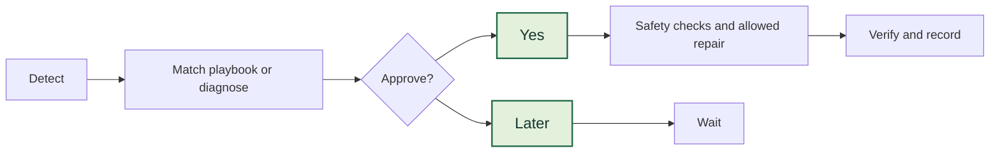

# SystemX

**A Windows helper that detects PC problems, offers safe repairs, and records the result.**

It runs quietly in the tray. Local playbooks handle common problems; an optional AI helps with unfamiliar ones, using read-only checks and a fixed repair list. Repairs require your approval by default. Autopilot is optional and off by default.

## Try it

- **Packaged app:** download `SystemAutoBot-windows.zip` from [Releases](https://github.com/NghiemNgocDuc/SystemX/releases), unzip, and run `Install.cmd`.
- **From source:** on Windows with Python 3.11+, run:

  ```powershell
  py -3.12 -m venv .venv
  .venv\Scripts\python.exe -m pip install -e ".[grok,ui,dev]" httpx
  .venv\Scripts\python.exe -m systemautobot app --show
  ```

  Use your installed Python version. AI setup is optional; keys are stored in Windows Credential Manager.

## Pipeline



## Demos

Run `lab\Start-Demo.cmd` after source setup for live frozen-app and disposable-file-cleanup demos. Both use the normal approval box and make no changes outside their demo data. See [DEMO.md](DEMO.md).

Build it with `.venv\Scripts\python.exe packaging\build_site.py`, then open `_site\demo.html`. It is a simulation and does not change your PC.

## Development

```powershell
.venv\Scripts\python.exe -m pytest
powershell -ExecutionPolicy Bypass -File packaging\build.ps1
```

[Background operation](BACKGROUND.md) · [Demo guide](DEMO.md) · [5-minute demo script](DEMO_SCRIPT.md) · [Build plan](PLAN.md)
