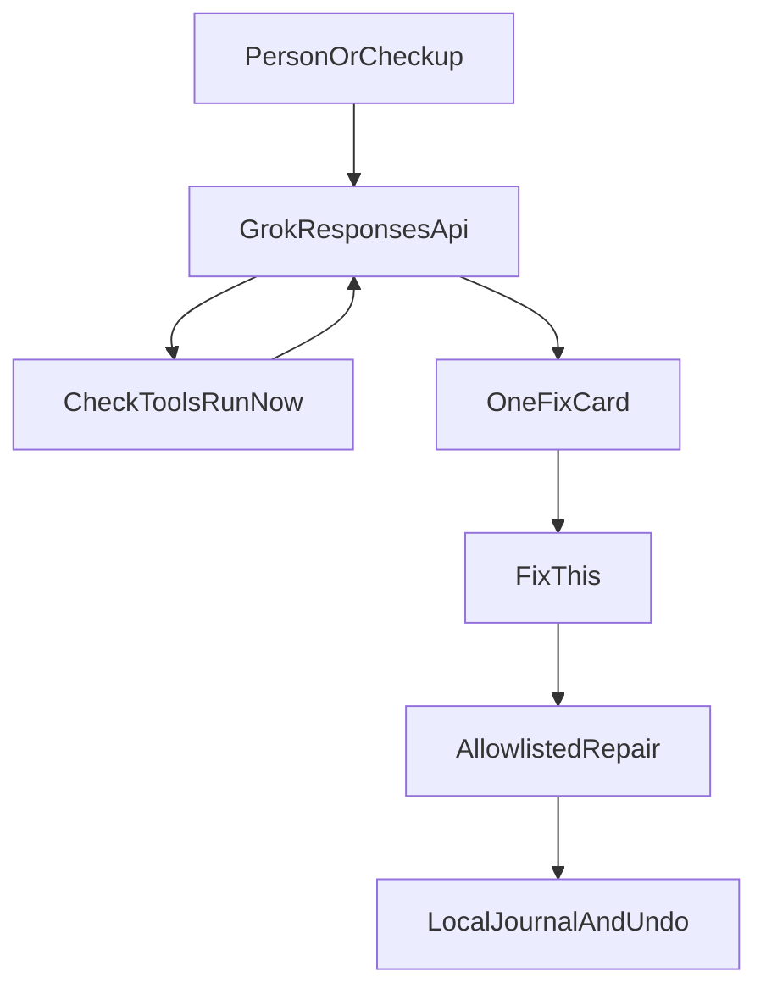

# SystemAutoBot: Grok on the PC, doing the computer care

This repository holds the plan for SystemAutoBot. The app is not built yet.

SystemAutoBot lives in the Windows tray and talks like [Claw](https://www.genspark.ai/helpcenter/genspark-claw): the person describes a problem, or the helper speaks first. The brain is [Grok](https://docs.x.ai/developers/tools/function-calling) through the person's own xAI API key. Grok decides what to look at and which repair fits. The hands are local tools that cover the work a person actually does by hand to check and fix a Windows PC.

A check runs as soon as Grok asks for it. A fix waits on a card until the person presses **Fix this**. The card, the log, and undo stay in the app, so a strong model still cannot skip the warning or hide what changed.

## What the person feels

The window is a chat. The tray is home. There is no account and no dashboard of gauges.

1. First run asks for the xAI API key, with a link to the [xAI console](https://docs.x.ai/developers/quickstart). The key is stored in Windows Credential Manager. It is never written into the repo, the chat log, or a traceback.
2. They press **Check this computer**. Local checks run first. Grok is called only when something looks wrong, or when the person types.
3. Grok looks up what it needs (space, crashes, network, the frozen app) and answers in a short sentence plus one card.
4. **Fix this** performs that one repair. The same card then says what happened and offers **Undo** when a way back exists.
5. If they paste an unfamiliar error, Grok reads the local evidence, explains it, and chooses a repair from the toolbox. If none fits, it says so and leaves the PC alone.

Quick replies when idle: **Check the computer**, **Free up space**, **Something broke**. Ctrl+Alt+Space opens the tray popover. Closing the window leaves the helper running. One toast per new problem, and none over a fullscreen app.

Voice stays plain: "I", program names as shown on screen, one idea per message. Technical names stay under **More detail**. Status words are Fine, Needs you, Working, Done, and Couldn't. If the API is down or the key is missing, the only line is "I can't reach Grok right now. I didn't change anything."

## How Grok is wired

Use the Responses API, which is the current tool-calling path. Chat Completions is legacy and drops reasoning between steps.

- `POST https://api.x.ai/v1/responses`
- Default model `grok-4.7`, changeable in Settings
- Official client shape: OpenAI SDK with `base_url="https://api.x.ai/v1"` and the key as the bearer token
- `store: false`, so this computer's errors are not kept on xAI's 30-day response store
- Send `reasoning.encrypted_content` back with the next step so Grok keeps its plan across tool calls
- Reasoning effort `high` when diagnosing an error, `medium` for a short follow-up
- At most 8 tool rounds per message
- Tool results are trimmed before they go back: 20 rows, 500 characters per error text

The app executes every tool locally. Grok's hosted code-execution tool is not enabled. A tool name that is not in the app is refused and reported back as an error result. Grok never receives a shell.

What is sent to xAI: the person's words, the conversation, and the check results (free space, program names, event summaries, up or down, service state). What is not sent: the API key, documents, photos, mail, passwords, browser history, or a full listing of personal folders.

A daily checkup is local and silent when the PC is fine, so an idle computer does not spend API calls. Grok runs when a checkup finds trouble or the person speaks.

## Checks Grok can do on its own

These are the things a person would open Settings, Task Manager, or Event Viewer to see. They do not change the PC.

- Drive space in GB and MB, and the largest folders near the top of the user profile
- Apps that are open, how much memory they use, and which one says Not Responding
- Recent Windows errors, translated far enough to name the program
- Network: connected or not, Wi-Fi or Ethernet, whether a simple lookup works
- Windows Update status and whether a restart is waiting
- Startup programs, problem devices, the print queue, and the current sound output
- Disk health summary when Windows already exposes it
- A named app's version, and whether its known cache folder is large

Listing a folder returns names and sizes. Reading a file is limited to a Windows event the checkup already surfaced, or a log the person pasted into the chat.

## Fixes Grok can do after Fix this

This is the helpdesk work a person would otherwise click through. Each tool validates its arguments, writes a journal row, and either undoes or says on the card, before the button, that undo is impossible.

- Set temporary files and known caches aside on the same drive for 30 days, then put them back. Cookies, passwords, and history are not part of the cache tool.
- Close, open, or restart a program. Closing warns that unsaved work in that window will be lost. Windows sign-in and other system processes are refused.
- Refresh the network connection, saving the current DNS servers for undo.
- Restart Windows only after a countdown the person can cancel.
- Turn off one startup program, remembering the previous setting.
- Cancel a stuck print job, or start the print service again.
- Switch the sound output back to the device that was active before.
- Open the exact Windows Settings page for a problem the toolbox cannot finish itself.
- Elevated repairs from a fixed list only: System File Checker, DISM restore, Winsock reset, and restarting the Windows Update service. Each one creates a restore point first, asks through the normal Windows permission prompt, and records the command that actually ran. The command text is chosen by the app from that list. Grok chooses the list entry, not the command string.

Protected from the file tool even if Grok names them: `C:\Windows`, both Program Files trees, `C:\ProgramData`, drive roots, the profile root, Documents, Desktop, Pictures, Videos, mail, SSH keys, and cloud-synced files. Links are not followed. OneDrive is described, not deleted.

Quarantine paths: `%LOCALAPPDATA%\SystemAutoBot\quarantine\{run_id}\` on C:, and `{drive}:\SystemAutoBot\quarantine\{run_id}\` on other drives. Expired holds come back as their own card. Undo renames files back, or beside the original if the name is taken.

One card at a time. A second repair waits until the first card is Done or Couldn't. The plan on a card expires after 15 minutes, and the app re-checks the target immediately before acting. An exception stops the rest of the repair, stores the Python traceback in `%LOCALAPPDATA%\SystemAutoBot\logs\app.log`, and leaves finished steps undoable.

## Chat, activity, and memory

The card is the approval. It shows what happened, what Grok will do, and what the person should know. **More detail** expands the files, sizes, or error text. Buttons disable while the step runs.

Activity is a story: "Today, 2:14 PM. Set aside 3.8 GB of temporary files. Undo." Settings stay short: the key, the model, how often to look, the free-space warning (10, 20, or 40 GB), quarantine days, and **Remembered choices** with Remove. Remembered choices are local: problems dismissed for today, repairs they never want offered, and the warning level. The footer says that fixes stay on this PC and that conversation is sent to Grok with the key.

Look: Segoe UI, 16px, one accent for **Fix this**, 44px buttons, visible focus, Windows light or dark, reduced motion respected. No emoji icons and no glass blur.

## Build

Python 3.12, pytest, a localhost server on `127.0.0.1`, and `pystray`. Approve is a POST with a per-launch token and a matching Origin. A Startup shortcut and a mutex keep a single tray process.

- [src/systemautobot/grok/client.py](src/systemautobot/grok/client.py) calls `/v1/responses`, loops tool results, and drops the key from every log
- [src/systemautobot/tools/checks.py](src/systemautobot/tools/checks.py) is the read-only toolbox
- [src/systemautobot/tools/fixes.py](src/systemautobot/tools/fixes.py) is the repair toolbox and the elevated allowlist
- [src/systemautobot/safety/guard.py](src/systemautobot/safety/guard.py) is the only file move and the process-close guard
- [src/systemautobot/journal.py](src/systemautobot/journal.py) stores runs, undo, memory, and tracebacks
- [src/systemautobot/web/](src/systemautobot/web/) is first run, chat, cards, activity, and settings
- [src/systemautobot/tray.py](src/systemautobot/tray.py) is the popover, toast, and close-to-tray
- [tests/](tests/) use a fake Grok client so the suite never calls xAI

The safety shape follows [Sifty](https://github.com/Vortrix5/sifty), [DiskPilot](https://github.com/anilkumara9/diskpilot), and [Ebb](https://github.com/ege-arhan/ebb): one destructive path, a preview, and a journal. The reach comes from Grok choosing among many real repairs, which is what makes an unfamiliar error fixable without handing the model a blank command line.

## Implementation checklist

- Scaffold the app, the journal, and the guards. Check tools may run during a Grok turn. Fix tools run only after Fix this.
- Add the xAI Responses API client, Windows Credential Manager key storage, `store: false`, and a bounded tool loop.
- Implement the read-only helpdesk checks Grok can run on its own, with truncated results and no personal file contents.
- Implement the repair tools a person would run by hand, each with a card, a journal row, and undo or a stated warning.
- Build first-run, chat, action cards, tray life, and the fallback line used when Grok cannot be reached.
- Test unknown-tool refusal, fix-without-approval refusal, key redaction, undo, and the unsaved-work warning.
