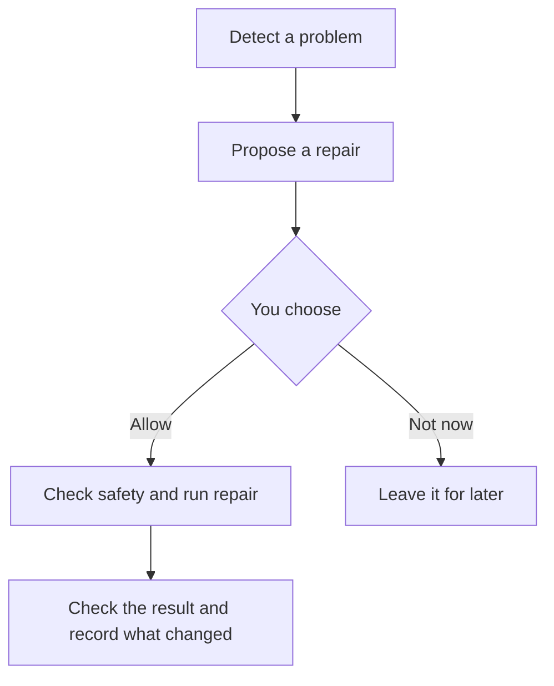

# SystemAutoBot

**A Windows helper that spots PC problems, offers a repair, and shows what changed.**

SystemAutoBot runs quietly in the tray. Built-in repairs handle common problems locally; an optional AI connection helps explain unfamiliar errors. Repairs ask for approval by default, then check the result and save a record in **Activity**.

## See it work

Two live demos use disposable data and the app's normal **Allow / Not now** approval box:

| Demo | What happens | What you can verify |
| --- | --- | --- |
| **Frozen app** | Demo Notes freezes. SystemAutoBot detects it and offers to close and reopen it. | Type in the reopened window; inspect the repair record. |
| **Free up space** | The demo creates six test files totaling 24 MiB, then offers to remove them. | Compare before and after sizes with the recorded bytes removed. |

Both demos work without an AI key. Cleanup scans its own test folder; it does not fill your drive or clean personal folders.

After source setup below, run:

```powershell
lab\Start-Demo.cmd
```

If SystemAutoBot is already running, choose **Quit** from its tray menu first. See [DEMO.md](DEMO.md) for the walkthrough.

## How it works



Known problems use local playbooks. For unfamiliar errors, the AI can run read-only checks and suggest a repair from a fixed list. It has no unrestricted shell. **Autopilot is off by default**; enabling it allows eligible repairs to run automatically through the same safety checks and history.

## Run it

**Windows app:** download `SystemAutoBot-windows.zip` from [Releases](https://github.com/NghiemNgocDuc/SystemX/releases), unzip it, and run `Install.cmd`.

**From source:** on Windows with Python 3.11 or newer, run these commands from the repository folder:

```powershell
py -3.12 -m venv .venv
.venv\Scripts\python.exe -m pip install -e ".[grok,ui,dev]" httpx
.venv\Scripts\python.exe -m systemautobot app --show
```

Use your installed Python version in the first command. AI setup is optional; provider keys are stored in Windows Credential Manager. Built-in repairs work without them.

**Background operation:** closing the window keeps monitoring running. Reopen it from the tray or with **Ctrl+Alt+Space**; choose **Quit** to stop it. The installer adds startup at Windows sign-in. See [BACKGROUND.md](BACKGROUND.md).

## Develop

```powershell
# Run tests
.venv\Scripts\python.exe -m pytest

# Build the website and browser demo
.venv\Scripts\python.exe packaging\build_site.py

# Build the Windows package
powershell -ExecutionPolicy Bypass -File packaging\build.ps1
```

Open `_site\demo.html` for the interactive browser walkthrough. It is a **simulation** and makes no PC changes.

| Area | Code |
| --- | --- |
| Detection and repair flow | [watcher.py](src/systemautobot/watcher.py), [pipeline.py](src/systemautobot/pipeline.py), [playbooks](src/systemautobot/playbooks/) |
| Safety and repair records | [guard.py](src/systemautobot/safety/guard.py), [history.py](src/systemautobot/history.py) |
| AI and app interface | [AI integration](src/systemautobot/grok/), [web UI](src/systemautobot/web/), [desktop and tray](src/systemautobot/ui/) |

[Demo guide](DEMO.md) · [Background behavior](BACKGROUND.md) · [Build plan](PLAN.md)
