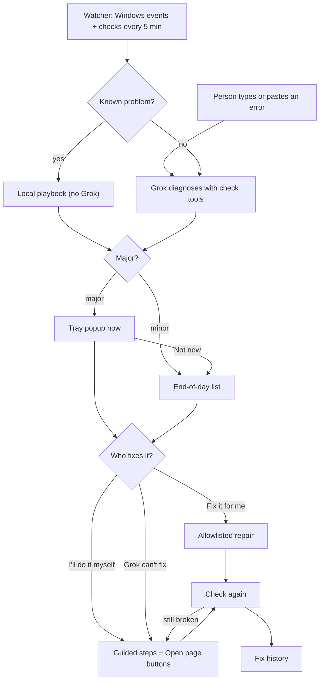
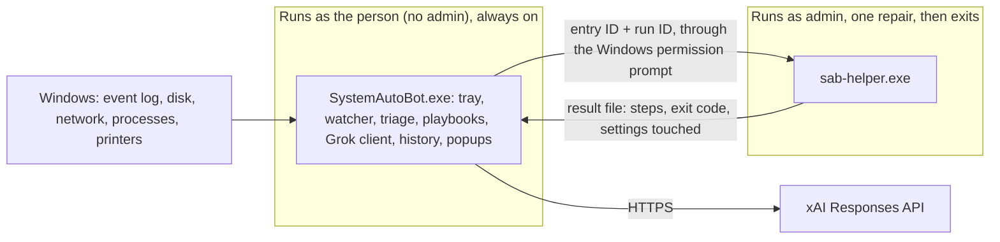

# SystemAutoBot: Grok on the PC, doing the computer care

This repository holds SystemAutoBot and its plan. The build order is in [PLAN.md](PLAN.md), and how we test and demo it is in [DEMO.md](DEMO.md). The project website is [site/landing.html](site/landing.html), published to GitHub Pages by [.github/workflows/pages.yml](.github/workflows/pages.yml). The interactive browser simulation is in [site/demo.html](site/demo.html) and is published as `/demo.html`.

## Try it

**Download:** get `SystemAutoBot-windows.zip` from [Releases](https://github.com/NghiemNgocDuc/SystemX/releases), unzip it, and double-click `Install.cmd`. No admin rights are needed. On first launch, pick an AI provider (xAI Grok by default, or OpenAI, Anthropic Claude, Google Gemini, Groq, OpenRouter, or any OpenAI-compatible service), paste your key, load your models, and press **Test and save**. The key goes into Windows Credential Manager.

**From source** (Python 3.11 or newer):

```powershell
py -3.11 -m venv .venv
.venv\Scripts\python.exe -m pip install -e ".[grok,ui,dev]"
.venv\Scripts\python.exe -m pytest                         # the whole suite, no network, no PC changes
.venv\Scripts\python.exe -m systemautobot app --demo       # the desktop app, checks every 10 s
.venv\Scripts\python.exe -m systemautobot check            # every read-only check once
powershell -ExecutionPolicy Bypass -File packaging\build.ps1   # dist\SystemAutoBot-windows.zip
```

**Try the demo:** open [site/demo.html](site/demo.html) for a browser-only simulation; it does not inspect or change your computer. To see a real, local recovery on disposable demo notes, install the demo panel dependency and run the guided launcher:

```powershell
.venv\Scripts\python.exe -m pip install httpx
lab\Start-Demo.cmd
```

The launcher starts the app in demo/lab mode and opens the live demo panel. The panel never approves a repair: detection and repair happen in the app, where you must choose **Allow**. The main recovery works without an AI key or internet. See [DEMO.md](DEMO.md) for setup and safety details.

**Release:** push a tag such as `v0.1.0`. [.github/workflows/release.yml](.github/workflows/release.yml) tests, builds the zip on Windows, and attaches it to a GitHub Release, which is where the website's Download button points.

SystemAutoBot lives in the Windows tray and talks like [Claw](https://www.genspark.ai/helpcenter/genspark-claw): the person describes a problem, or the helper speaks first. The brain is [Grok](https://docs.x.ai/developers/tools/function-calling) through the person's own xAI API key. The hands are local tools that cover the work a person actually does by hand to check and fix a Windows PC.

A check runs as soon as it is needed. A fix waits until the person approves it: **Fix this** on a card, **Fix now** on a popup, or **Fix it for me** in the end-of-day list. All three are the same approval. The card, the fix history, and undo stay in the app, so a strong model still cannot skip the warning or hide what changed.

## Does Grok live on the computer?

No. Grok is a cloud model. Its weights are not something a home PC can run, and the current model is only available through the xAI API. What lives on the computer is the SystemAutoBot **watcher**: a small always-on tray process that sees errors as they happen, decides how serious they are, and calls Grok over HTTPS only when it needs a diagnosis it does not already have.

That split has one hard consequence: **the app must still work when Grok cannot be reached.** "No internet" is one of the most common problems people have, and it is exactly the moment Grok is out of reach. So common problems are handled by local **playbooks** that need no Grok at all. Grok handles unfamiliar errors, explanations, and anything the person types.

## What the person feels

The window is a chat. The tray is home. There is no account and no dashboard of gauges.

1. First run asks for the xAI API key, with a link to the [xAI console](https://docs.x.ai/developers/quickstart). The key is stored in Windows Credential Manager. It is never written into the repo, the chat log, the fix history, or a traceback.
2. The watcher starts and stays on. It is silent while the PC is fine.
3. When something **major** breaks (the drive is nearly full, the internet is down, the program in front of them froze), a popup rises from the tray right away and asks: "Can I fix this now?"
4. When something **minor** is found (a startup slowdown, a stuck print job nobody is waiting on, an update that failed once), it waits. At the end of the day, one popup lists everything and asks, item by item, whether Grok should fix it or the person wants to do it themselves.
5. **Fix it for me** performs that one repair. The card then says what happened and offers **Undo** when a way back exists.
6. **I'll do it myself** shows short steps with buttons that open the exact Windows page, then **Check again** to confirm it worked.
7. If they paste an unfamiliar error, Grok reads the local evidence, explains it, and chooses a repair from the toolbox. If none fits, it says so, offers steps the person can follow, and leaves the PC alone.

Quick replies when idle: **Check the computer**, **Free up space**, **Something broke**. Ctrl+Alt+Space opens the tray popover. Closing the window leaves the helper running.

Voice stays plain: "I", program names as shown on screen, one idea per message. Technical names stay under **More detail**. Status words are Fine, Needs you, Working, Done, and Couldn't. If Grok cannot be reached for an unfamiliar error, the line is "I can't reach Grok right now. I didn't change anything." Known problems still get their card, because they do not need Grok.

## How Grok is wired

Use the Responses API, which is the current tool-calling path. Chat Completions is legacy and drops reasoning between steps.

- `POST https://api.x.ai/v1/responses`
- Default model `grok-4.7`, changeable in Settings. Confirm the current model name against the xAI docs at build time.
- Official client shape: OpenAI SDK with `base_url="https://api.x.ai/v1"` and the key as the bearer token
- `store: false`, so this computer's errors are not kept on xAI's 30-day response store
- Send `reasoning.encrypted_content` back with the next step so Grok keeps its plan across tool calls
- Reasoning effort `high` when diagnosing an error, `medium` for a short follow-up
- At most 8 tool rounds per message
- Tool results are trimmed before they go back: 20 rows, 500 characters per error text
- Error text from Windows events and pasted logs is wrapped and labeled as untrusted data. It can describe a problem. It cannot ask for a tool.
- Grok is called for a **known** problem only when the person asks "why?" under **More detail**. The card itself comes from the playbook.

The app executes every tool locally. Grok's hosted code-execution tool is not enabled. A tool name that is not in the app is refused and reported back as an error result. Grok never receives a shell.

What is sent to xAI: the person's words, the conversation, the check results (free space, program names, event summaries, up or down, service state), and for a repeat problem, a one-line summary of past fixes (problem, fix name, outcome). What is not sent: the API key, documents, photos, mail, passwords, browser history, file paths from the fix history, or a full listing of personal folders.

## The fix pipeline

Every problem, whether the watcher found it or the person typed it, goes through the same stages.



1. **Watch.** The watcher subscribes to the Windows event log (crashes, hangs, disk, update, power, security events) and runs cheap local checks every 5 minutes and at sign-in. It costs no API calls.
2. **Match.** Each signal gets a fingerprint (problem type plus program or device). A fingerprint that matches a playbook is a known problem. Anything else is an unfamiliar error.
3. **Triage.** Severity comes from a fixed local rule table, not from Grok. For an unfamiliar error Grok may raise the severity, never lower it. Duplicates are merged, and remembered choices ("never offer this") are applied.
4. **Diagnose.** Known problems: the playbook runs its checks. Unfamiliar major errors: Grok is called now. Unfamiliar minor errors: Grok is called 15 minutes before the end-of-day list, in one batch, so the cards are ready.
5. **Ask.** Major: popup now. Minor: end-of-day list. The person can always open the chat and get anything right away.
6. **Fix.** The app runs the approved repair, or the person follows the steps, or the item is marked as something only a person can do.
7. **Verify.** The same check that found the problem runs again. The result is Fixed, Didn't fix it, or Waiting for restart.
8. **Record.** Every outcome, including "went away on its own" and "you fixed it", goes into the fix history.
9. **Learn.** If the same fingerprint has been fixed 3 times in 14 days, the quick fix is no longer offered. The card switches to the root-cause steps and Grok is shown the history summary.

## When the helper speaks up

**Major problems ask right away.** A popup rises from the tray with one sentence, what the fix will do, and three buttons: **Fix now**, **Not now**, and **More detail**. If there is no fix the app can run, the buttons are **Show me how** and **Remind me later**.

- The popup is the app's own window, not only a toast, so it does not vanish into the notification center.
- It waits while a fullscreen app, a game, or a presentation is running (`SHQueryUserNotificationState`) and while the PC is locked. Meanwhile the tray icon shows Needs you.
- At most 3 major popups per hour. Anything beyond that is grouped into one popup: "3 more things need you."
- **Not now** moves the item to the end-of-day list. The same problem does not pop up again for 4 hours unless it gets worse (for example, free space keeps falling).
- Nothing is ever fixed without a click, major or not.

**Minor problems wait for the end of the day.** At 6:00 PM local time (changeable in Settings), one popup lists the day's minor items. Each row has **Fix it for me**, **I'll do it myself**, **Not now**, and **Never for this**. **Fix the ones I checked** counts as approval for each checked row. They run one at a time, and elevated ones still show the Windows permission prompt each time.

- Each item is checked again right before the list is shown. Problems that went away on their own are dropped from the list and recorded as such.
- If the PC is off or asleep at that time, the list appears once at the next sign-in or unlock.
- **Not now** rolls the item to tomorrow. After 3 roll-overs it is shown with "This has been waiting since Monday."
- An empty day shows nothing.

## Common problems it handles

These are the problems a lot of people hit and the repairs a helpdesk would actually do. Each one is a playbook in `src/systemautobot/playbooks/` with its detection, severity rule, fix, manual steps, and verification. Things that rarely help or that cause more trouble than they fix are left out on purpose: registry cleaners, driver updaters, "RAM boosters", defragmenting SSDs, and uninstalling apps for the person.

| Problem | How the watcher spots it | Severity | Fix it for me | I'll do it myself |
| --- | --- | --- | --- | --- |
| Drive almost full | Free space check | Major under 2 GB, or under 5% while also below the warning level. Minor under the warning level (10, 20, or 40 GB) | Delete temp files and known caches. Empty the Recycle Bin. Each one is its own card, with no undo. | Biggest-folders list, then Storage settings. Move or delete your own files, or uninstall apps you don't use. |
| Program frozen | Window hung over 30 s, Application Hang event 1002 | Major if it's the window in front, minor if it recovered | Close and reopen it, with the unsaved-work warning | Wait a minute, or End task in Task Manager |
| Taskbar, Start, or File Explorer stuck | Explorer hung | Major | Restart Windows Explorer (files are not affected) | Ctrl+Shift+Esc, Windows Explorer, Restart |
| No internet | Adapter connected but two lookups in a row fail | Major | Refresh the connection (flush DNS, renew address). If the clock is wrong, sync the time. If that fails: reset Winsock (elevated, needs restart). | Restart the router, check the Wi-Fi password, turn off the VPN, Network settings |
| An app keeps crashing | Application Error event 1000, same app | Major at 3 crashes in an hour, minor otherwise | Clear that app's known cache, then reopen it | Update or reinstall it from Installed apps |
| Windows Update stuck or failing | Update failure event 20 for the same update twice, or a restart pending over 3 days | Minor | Reset the Windows Update components (elevated). Restart with a countdown. | Windows Update troubleshooter, or install that update by hand |
| Slow startup | Boot over 2 minutes (Diagnostics-Performance event 100) | Minor | Turn off startup programs the person picks | Startup apps page |
| Print job stuck | Job in error for over 10 minutes | Minor (right away if the person asks) | Cancel the job. Restart the print service (elevated). | Check paper and power, Printers page |
| No sound | Default output changed or the device disappeared | Minor | Switch back to the device that was active before | Sound settings, check the cable or Bluetooth |
| System files damaged | Repeated crashes in Windows parts, servicing errors | Minor | DISM restore, then System File Checker (elevated) | None needed |
| Out of memory | Resource-Exhaustion-Detector event 2004 | Major | Close the program using the most memory, with the unsaved-work warning | Restart the PC, turn off startup programs |
| Protection off | `Get-MpComputerStatus`: real-time protection off while Windows Security is the active antivirus | Major | None: Tamper Protection rightly blocks apps from switching it on | Open Windows Security and turn real-time protection on |
| Virus definitions old | `Get-MpComputerStatus`: definitions more than 3 days old | Minor | Update the virus definitions (admin) | Windows Security, Check for updates |
| Firewall off | `Get-NetFirewallProfile`: Private or Public off, and no other firewall registered with Windows | Major | Turn the firewall back on (admin) | Windows Security, Firewall & network protection |
| Error message on screen | A standard error box (dialog text like "error", "failed", "0x8007…") on screen for two checks in a row | Minor, shown on Home at once | **Fix for me** opens think mode: the AI looks, step by step, and may propose one fix from the list | Restart the program, then update or reinstall it |
| Disk failing | Disk events 7, 51, 153, Ntfs 55, or the drive's own health (`Get-PhysicalDisk`) not Healthy | Major | **Check the drive and open Backup**: opens Windows Backup, then Windows' online drive check (`chkdsk /scan`, not the full surface scan). It never claims the drive is cured. | Back up now (opens backup settings), then replace the drive |
| Blue screen on last boot | Kernel-Power 41 with BugCheck 1001 | Major, shown after sign-in | None, unless the crash names no driver, then the system file repair | If a driver is named: Device Manager, roll back or update that driver |

## Checks the app and Grok can run on their own

These are the things a person would open Settings, Task Manager, or Event Viewer to see. They do not change the PC.

- Drive space in GB and MB, and the largest folders near the top of the user profile
- Apps that are open, how much memory they use, and which one says Not Responding
- Recent Windows errors, translated far enough to name the program
- Network: connected or not, Wi-Fi or Ethernet, whether a simple lookup works, and whether the clock is close enough to the real time for secure connections
- Windows Update status and whether a restart is waiting
- Startup programs, problem devices, the print queue, and the current sound output
- Disk health summary when Windows already exposes it
- Windows Security status: protection on or off, last scan, unresolved threats
- Whether this account is an administrator, whether the PC is managed by work or school, and whether System Protection is on
- A named app's version, and whether its known cache folder is large

Listing a folder returns names and sizes. Reading a file is limited to a Windows event the checkup already surfaced, or a log the person pasted into the chat.

## Fixes the app runs after approval

This is the helpdesk work a person would otherwise click through. Each tool validates its arguments, opens a fix history record before it starts, writes every step into it, and either offers undo or says on the card, before the button, that undo is impossible.

- Delete temporary files and known caches. These are rebuilt by Windows and the apps, so they are deleted, not set aside. The card says "You can't undo this" before the button. Cookies, passwords, and history are not part of the cache tool.
- Empty the Recycle Bin, as a separate card with its own size and the same no-undo line.
- Close, open, or restart a program. Closing warns that unsaved work in that window will be lost. Windows sign-in and other system processes are refused. Windows Explorer is the one system process allowed, through its own restart tool.
- Refresh the network connection, saving the current DNS servers for undo.
- Restart Windows only after a countdown the person can cancel.
- Turn off one startup program, remembering the previous setting.
- Cancel a stuck print job.
- Switch the sound output back to the device that was active before.
- Run a Windows Security quick scan.
- Open the exact Windows Settings page for a problem the toolbox cannot finish itself.
- Elevated repairs from a fixed list only: System File Checker, DISM restore, Winsock reset, time sync, setting DNS back to automatic, restarting the print service, resetting the Windows Update components, updating the virus definitions, turning the firewall back on, and Windows' online drive check (10 built; turning off an "all users" startup program is planned). Each one asks through the normal Windows permission prompt and records the command that actually ran. The command text is chosen by the app from that list. Grok chooses the list entry, not the command string.
- Before an elevated repair, the app tries to create a restore point. Windows allows only one every 24 hours and many PCs have System Protection turned off, so the card says which case applies before the button: "I'll make a restore point first", "I'll use the restore point from 9:12 AM today", or "No restore point is possible because System Protection is off."

Protected from every file tool even if Grok names them: `C:\Windows` (except through the elevated list above), both Program Files trees, `C:\ProgramData`, drive roots, the profile root, Documents, Desktop, Pictures, Videos, Downloads, mail, SSH keys, and cloud-synced files. Links are not followed. OneDrive is described, not deleted.

One card at a time. Waiting cards are ordered by severity, then age. A second repair waits until the first card is Done or Couldn't. The plan on a card expires after 15 minutes, and the app re-checks the target immediately before acting. An exception stops the rest of the repair, stores the Python traceback in `%LOCALAPPDATA%\SystemAutoBot\logs\app.log`, and leaves finished steps undoable. A repair that ran and did not fix the problem is tried at most twice per problem per day, then the card moves to the manual steps.

## Fixes the person does

Some problems need hands, a password, a purchase, or a choice only the person can make. The app does not pretend otherwise. It gives them a short guided path:

1. One sentence on what is wrong and why the app can't do it.
2. Three to six numbered steps. For known problems the steps are written into the playbook and reviewed. For unfamiliar errors Grok writes them, and they are labeled "Grok's suggestion. I haven't checked these." The app never runs them.
3. **Open** buttons that go straight to the right page (`ms-settings:storagesense`, `ms-settings:network-status`, `ms-settings:windowsupdate`, `ms-settings:appsfeatures`, `ms-settings:startupapps`, `ms-settings:sound`, `ms-settings:printers`, `windowsdefender:`, Device Manager).
4. **Check again**, which runs the detection and records Fixed or Still broken.

The common manual-only cases: backing up and replacing a failing drive, installing or rolling back a driver, deleting or moving the person's own files, uninstalling an app, restarting the router or re-entering a Wi-Fi password, signing back in to OneDrive, an offline malware scan, and anything on a PC run by work or school IT.

## Pressure test: errors Grok cannot fix

These are the cases where Grok, the app, or both cannot solve the problem, and what the plan does about each.

| Case | What would go wrong | What the plan does |
| --- | --- | --- |
| No internet | Grok can't be reached at the moment the person needs help most | Known problems run from local playbooks. The network playbook works fully offline. |
| API key missing, revoked, or out of credit (401, 403) | Every Grok call fails | Known problems still work. Unfamiliar ones say the key needs attention, with a Settings button. |
| Rate limited or xAI down (429, 5xx) | Diagnosis stalls | One retry with backoff, then the item waits in the end-of-day list, not an error loop |
| PC clock is wrong | Secure connections fail, which looks like "no internet" and "Grok is down" | The network check compares the clock with a lookup's time and offers a time sync first |
| Failing hardware (disk, RAM, heat, battery) | Software can't repair it, and write-heavy repairs can make data loss worse | Major popup says "Back up now". On a failing disk, SFC, DISM, and cache deletion are not offered. |
| PC won't boot, or a blue-screen loop | The app never starts | Out of scope. After a good boot, it reads the crash record and explains which driver it names. |
| Driver problems | Grok can't download or install drivers, and fetching installers from the web is a supply-chain risk | Never automated. Manual steps name the device and open Device Manager. |
| Malware Windows Security can't remove | The app has no business trying | Quick scan only. Then manual steps for the offline scan. |
| Standard account with no admin password | Elevated fixes fail at the permission prompt | Detected first. The card says "This needs an administrator" before the button. If it fails anyway, it is recorded as Couldn't. |
| Work or school PC (domain, Entra, Intune) | Policy blocks or quietly reverts the repair | Detected at first run. Elevated fixes and startup changes are hidden. Checks and manual steps remain, with "Ask your IT team." |
| No restore point possible | The draft promised one before every elevated fix | The card says which restore point will be used, or that none is possible, before the button |
| DISM needs Windows Update | It fails offline, or when Windows Update itself is broken | Not offered while offline. A failure (such as `0x800f081f`) is recorded as Couldn't, with manual steps. |
| Grok picks a valid but wrong fix | The problem is still there after the repair | Verify catches it, the card says "That didn't fix it", and there are at most 2 tries a day before the manual path |
| The problem keeps coming back | Quick fixes hide a root cause | 3 fixes in 14 days stops the quick fix and shows root-cause steps |
| Error text tries to give instructions (prompt injection) | A log or event message tells Grok to run something | Event text is labeled as untrusted, Grok can only pick allowlisted tools, and every fix needs a click. Covered by a test. |
| No tool fits the error | Grok might improvise | Grok explains, offers labeled suggestion steps, and the app changes nothing |
| Power loss or crash mid-repair | Half-finished state, nobody knows what ran | A history record that started but never finished becomes an "Interrupted repair" card at next launch, with a re-check and undo of finished steps |
| Same-drive quarantine (from the first draft) | Moving temp files to a folder on the same drive frees zero bytes for 30 days | Regenerable temp files and caches are deleted, with "no undo" on the card. The app does not touch personal files, so it needs no quarantine. |
| Fix needs a restart to take effect (Winsock, Windows Update reset) | It can't be verified yet | The record stays "Waiting for restart" and is verified after the next sign-in |
| Many problems at once | A wall of popups | One card at a time, at most 3 major popups an hour, the rest grouped |

## Notifications, the Allow box, and Autopilot

- **A critical problem sends a Windows notification** that names the problem and the fix that's ready. The main window is the summary and the history; it doesn't jump in front of you.
- **Clicking the notification opens a small box.** It says in one sentence what the fix is meant to do, shows any warning, and asks **Allow** or **Not now**. "Exactly what runs" lists each step and the real Windows command, one click away. After Allow, the box shows what changed and whether the re-check passed.
- **Autopilot (off by default, in Settings) fixes critical problems with no click.** It is a harness around the app's repairs and the AI agent, in [autopilot.py](src/systemautobot/autopilot.py):
  1. **Decide.** A built-in repair if the problem has one. Otherwise the AI agent looks with its read-only checks and may pick one repair from the fixed list.
  2. **Guard.** The harness, never the agent, decides whether it may run unattended. Only repairs marked safe: no administrator rights, and nothing that can lose work. Closing a frozen program is a second switch, because unsaved work is lost. Nothing runs while fixes are paused, nothing is deleted on a disk that may be failing, each problem gets one automatic try a day, and there are at most 3 automatic fixes an hour.
  3. **Act and verify.** Through the same runner as every other fix: the problem is re-checked first, every step is recorded, and the same check runs again afterwards.
  4. **Report.** A notification says what was done, and Activity marks the record "Autopilot, no click".
- **Admin repairs ask through the Windows prompt, unless you set up the no-prompt option.** It is off by default, in Settings → Autopilot. You switch it on from your own administrator account and Windows asks once. That installs one small script in `Program Files\SystemAutoBot\admin`, where only administrators can write, and one scheduled task per repair ([admin_setup.py](src/systemautobot/admin_setup.py)). It covers five quick repairs only: set the clock, update virus definitions, turn the firewall back on, restart the print service, and check the drive. Nothing with a restart, a restore point or a deletion is on the list, and the script takes no input except which of the five to run.
  - **The trade-off:** once installed, any program running in your Windows account could start those five repairs without a prompt, and nothing else. Switching the option off removes the script and the tasks.
- **What still comes to you:** every other admin repair, anything that could lose work, and anything Autopilot tried that didn't work. Each arrives as a notification, with the reason shown in the box.

## Fix for me and think mode

Every problem card has a **Fix for me** button. It opens think mode inside the card, so you see every step before anything changes:

- **Built-in repair:** the exact plan. Each step is listed in plain words with the real Windows command (for example `ipconfig /flushdns` or `sfc.exe /scannow`), which folders it may touch, whether it needs administrator rights, and whether it can be undone. Nothing runs until you press **Allow**.
- **No built-in repair:** the AI can look into it, but first you see exactly what would be sent, the rules the AI must follow, and the read-only checks it may run. Nothing is sent until you press **Send**. Then every step appears as it happens: what the AI says, its reasoning when the provider shares it, each check it runs and what that check saw, the tokens used, and its answer.
- **If the AI suggests a repair**, it can only pick one from the app's fixed list. The app builds the steps itself and shows the same exact plan, and nothing runs until you press **Allow**. **Stop** works at any time.
- **After Allow,** the card shows what ran, what changed, and the re-check, and the full record goes to Activity.

## Fix history

Every fix is recorded, whoever did it. The history answers three questions: what was wrong, what was done step by step, and what on this PC was touched.

Stored locally in `%LOCALAPPDATA%\SystemAutoBot\history.db` (SQLite). Records are append-only: later events such as verify or undo are added as new rows linked to the fix, never written over it. A fix tool cannot start without an open history record. That is enforced in the runner, not left to each tool.

Each fix record holds:

- **Problem:** title, fingerprint, severity, and where it came from (watcher, chat, or end-of-day list)
- **Timeline:** detected, asked, approved (and through which button: Fix now, Fix it for me, Fix this, or I'll do it myself), started, finished
- **Who fixed it:** the app's playbook, the app with Grok's choice, the person, or "went away on its own"
- **Summary:** one plain sentence built from what the steps actually returned, so it cannot claim more than happened. Example: "Deleted 3.8 GB of temporary files from 2 folders. The C: drive now has 14.2 GB free."
- **Steps:** an ordered list. Each step has the tool name and arguments, start and end time, result (Done, Couldn't, or Skipped), for elevated steps the exact command and exit code, and up to 500 characters of output.
- **Files touched:** path, action (deleted, moved, created, or changed), size, and last-modified time. Bulk deletes store a per-folder count and size in the record, and the full file list in `history\{fix_id}.files.jsonl.gz` (kept for 90 days, capped at 100,000 paths).
- **Settings touched:** registry values with old and new value, services with old and new state, startup entries, DNS servers, default sound device, restore point used
- **Verification:** Fixed, Didn't fix it, or Waiting for restart, and when it was checked
- **Undo:** available or not, available until when, and if used, a linked undo record with its own steps and files
- **Grok:** model, tool rounds, token count, and Grok's one-line reason for choosing the fix. No raw conversation is stored here.
- **Errors:** a pointer to the traceback in `app.log`

For "I'll do it myself", the record keeps the steps that were shown, which Open buttons were pressed, an optional note from the person, and the verification result. Files touched reads "Not tracked: you made these changes outside the app."

In the app, **Activity** becomes the history: newest first, filters by status, problem, and date, and a search box that answers "what touched this file or folder?" Each entry opens to Summary, Steps, Files and settings touched, and Undo. **Export** writes JSON or CSV. History is kept for 1 year by default (changeable in Settings) and never leaves the PC. Grok only ever sees the one-line summaries described above.

## Chat, activity, and memory

The card is the approval. It shows what happened, what will be done, and what the person should know. **More detail** expands the files, sizes, or error text. Buttons disable while the step runs.

Activity reads as a story backed by the fix history: "Today, 2:14 PM. Deleted 3.8 GB of temporary files. Details." Settings stay short:

- the key and the model
- how often to look
- the free-space warning (10, 20, or 40 GB)
- the end-of-day time
- what to ask about right away: major problems only (the default), or everything
- how long to keep history
- **Remembered choices**, each with Remove

Remembered choices are local: problems dismissed for today, repairs they never want offered, and the warning level. The footer says that fixes and their history stay on this PC and that conversation is sent to Grok with the key.

Look: Segoe UI, 16px, one accent for **Fix this** and **Fix now**, 44px buttons, visible focus, Windows light or dark, reduced motion respected. No emoji icons and no glass blur.

## How it plugs into Windows

The pipeline is two programs, and only one of them ever has admin rights, and only for one repair at a time.



**Install and start.** A per-user install into `%LOCALAPPDATA%\Programs\SystemAutoBot`, so installing needs no admin. It is packaged with PyInstaller. A Startup shortcut launches it at sign-in, and a named mutex keeps one copy running. Uninstall removes the shortcut and the app folder, and asks whether to keep the fix history.

**The main process never runs as admin.** If it is started elevated, it refuses and restarts itself unelevated. Everything that needs no admin runs here: the watcher, checks, playbooks, Grok calls, history, and the non-admin fixes.

**Admin repairs go through `sab-helper.exe`.**

- The tray starts it with `ShellExecute` and the `runas` verb, so Windows shows its own permission prompt every time.
- The helper accepts exactly two arguments: an allowlist entry ID (for example `sfc_scan`) and a run ID. It holds its own copy of the allowlist and builds the command itself.
- It never reads a command string from the tray, from a file, or from Grok. Anything that could run it without the tray can only trigger an allowlisted repair, and only after the Windows permission prompt.
- It writes a result file into that run's history folder and exits. There is no admin service running in the background. One was considered and rejected: an always-on SYSTEM service is a bigger target and needs an admin install.

**What the watcher hooks into:**

| Signal | Windows source | Notes |
| --- | --- | --- |
| Crashes, hangs, disk, update, power, out-of-memory events | `EvtSubscribe` on the Application and System logs | Readable without admin |
| Threats and protection off | `Microsoft-Windows-Windows Defender/Operational` | Readable without admin (checked 2026-11-14) |
| Slow boot | Time from sign-in to desktop ready, measured by the app | `Diagnostics-Performance/Operational` needs admin (access denied for a standard user, checked 2026-11-14), so it is not used |
| Free space | `shutil.disk_usage` every 5 minutes | No admin needed |
| Frozen windows | `EnumWindows` + `IsHungAppWindow` every 5 minutes | No admin needed |
| Internet up or down, clock wrong | DNS lookup + `http://www.msftconnecttest.com/connecttest.txt` (the address Windows itself uses), compare the response `Date` header with the PC clock | No admin needed |
| Print queue | `EnumJobs` through `pywin32` | No admin needed |
| Fullscreen, presentation, Do Not Disturb | `SHQueryUserNotificationState` | Decides when popups wait |
| Locked, unlocked, sleep, wake | `WTSRegisterSessionNotification`, `WM_POWERBROADCAST` | Used for waiting popups and missed end-of-day lists |

**Windows on screen.** The chat, cards, popups, and end-of-day list are the local web UI shown in `pywebview` windows (Edge WebView2, which ships with Windows 11). The tray icon is `pystray`. The local server binds to `127.0.0.1` only. Approve is a POST with a per-launch token kept in memory, never on disk, and a matching Origin.

**Permission limits each fix respects:**

- Startup programs installed "for this user" are turned off without admin. Ones installed "for all users" go through the helper.
- A program running as admin cannot be closed by the tray. That is recorded as Couldn't, never retried as admin.
- Files that are open or blocked by Windows Security's controlled folder access are skipped and counted in the summary. No file deletion asks for admin. The Windows temp folder is left out.
- If the DNS servers were set by hand to servers that don't answer (often left over from a VPN), refreshing the connection switches them back to automatic through the helper, saving the old ones for undo.
- Switching the sound output relies on an undocumented Windows feature. If it fails after a Windows update, the fix falls back to opening Sound settings.
- **Fix the ones I checked** with several admin fixes runs them in one helper launch, so there is one Windows prompt. Each fix was still shown on its own card first.

**Trust.** An unsigned program that deletes files and closes programs will get a SmartScreen warning on first run. That is acceptable for the hackathon. A real release needs code signing.

**Pause.** The tray menu has **Pause fixes**. While paused, it keeps checking but offers no fixes. Settings has the same switch.

**Demo mode.** `--demo` shortens the 5-minute checks to 10 seconds and a stuck print job to 30 seconds, opens the window at start, and adds **End of day now** to Settings and the tray menu. `--lab` enables the local-only endpoints used by the guided laptop demo; the normal app does not enable them. `lab\Start-Demo.cmd` starts both the app and guided panel with disposable Demo Notes. Separately, [site/demo.html](site/demo.html) is an interactive browser simulation that makes no PC changes. See [DEMO.md](DEMO.md).

## Compared with similar projects

We checked the closest open-source projects (November 2026) and took the good ideas that fit this plan.

| Project | What it is | What we took | Where we differ |
| --- | --- | --- | --- |
| [Eir](https://github.com/Swatto86/eir) | Rust Windows service + tray app that repairs the PC with AI CLIs | Watching for error boxes on screen, Windows Security and firewall checks, AI usage tracking, asking the AI only when the problem is new, a waiting queue that survives restarts | Eir's docs say it has no general undo, no restore points, and no spending cap. We have restore-point handling, a daily AI limit, an append-only fix history, an end-of-day list for small problems, guided fix-it-yourself steps, and a red-team suite. |
| [TroubleScout](https://github.com/sasler/TroubleScout) | Terminal assistant on the GitHub Copilot SDK, running PowerShell | A shareable HTML health report | It can run any PowerShell after approval. Our AI picks only from a fixed list of repairs and never sees a shell. |
| [pc-agent](https://github.com/usausa/pc-agent) | .NET terminal agent with hardware, S.M.A.R.T., and Wi-Fi collectors | Disk health from the drive's own report, and a self-check of what works on this PC | It runs in a terminal. Ours watches from the tray and speaks up on its own. |

The new pieces:

- **Error messages on screen:** a 3-second check for standard error boxes. A box must stay for two checks before it counts. The card shows on Home with **Fix for me**, which opens think mode. The box's text reaches the AI only as untrusted data, never a title or a button.
- **Windows Security and firewall:** real-time protection, virus definition age, and firewall per network type. It stays quiet when another antivirus or firewall is in charge.
- **Disk health:** `Get-PhysicalDisk` health, which a standard user can read. It has its own fingerprint, so a healthy report never clears an alarm raised by disk errors.
- **AI use:** every request is recorded (provider, model, purpose, tokens). Settings shows today's and this week's totals, with a daily limit (default 50). The same problem isn't sent to the AI twice within 24 hours.
- **Waiting problems survive a restart:** they're saved in `waiting.json` and re-checked at startup. Problems fixed while the app was closed are dropped, and urgent ones are never quietly downgraded.
- **Self-check** in Settings, and a **Health report** in Activity: a single HTML page with no keys, passwords, or file contents.

## Build

Python 3.11+, pytest, `pywin32` for the event log and Windows APIs, `psutil`, `keyring` for Credential Manager, the `openai` SDK as the client for every provider, FastAPI and uvicorn for the local server, `pywebview`, `pystray`, and PyInstaller. A Startup shortcut and a mutex keep a single tray process.

The AI is not limited to Grok. [grok/providers.py](src/systemautobot/grok/providers.py) lists the choices. xAI and OpenAI use the Responses API (`store: false`). Claude, Gemini, Groq (`gsk_` keys), OpenRouter, and custom services use Chat Completions, which [grok/transport.py](src/systemautobot/grok/transport.py) translates, so one tool loop serves all of them. Model lists come live from the provider with the person's key; nothing but the first suggestion is hard-coded.

- [src/systemautobot/app.py](src/systemautobot/app.py) starts everything: single instance, never admin, local server, watcher, tray, windows
- [src/systemautobot/grok/client.py](src/systemautobot/grok/client.py) is the bounded tool loop (8 rounds, one retry, untrusted-text wrapping); [grok/tools.py](src/systemautobot/grok/tools.py) is what the AI may call; [grok/service.py](src/systemautobot/grok/service.py) connects it to chat, diagnosis, and setup
- [src/systemautobot/watcher.py](src/systemautobot/watcher.py) subscribes to the event log (`EvtSubscribe`), runs the 5-minute checks, and fingerprints signals
- [src/systemautobot/triage.py](src/systemautobot/triage.py) is the one severity rule table, plus dedupe, rate limits, and the fullscreen and locked waits
- [src/systemautobot/playbooks/](src/systemautobot/playbooks/) is one file per common problem: detect, severity, fix steps, manual steps, verify
- [src/systemautobot/digest.py](src/systemautobot/digest.py) builds the end-of-day list, re-checks items, and carries them over
- [src/systemautobot/tools/checks.py](src/systemautobot/tools/checks.py) is the read-only toolbox
- [src/systemautobot/tools/fixes.py](src/systemautobot/tools/fixes.py) is the repair toolbox, the elevated allowlist, and the runner that refuses to start without a history record
- [src/systemautobot/safety/guard.py](src/systemautobot/safety/guard.py) is the only file delete path, the protected-path list, and the process-close guard
- [src/systemautobot/history.py](src/systemautobot/history.py) stores fix records, steps, files and settings touched, undo, remembered choices, and traceback pointers
- [src/systemautobot/web/](src/systemautobot/web/) is the local server and pages: first run (provider, key, model), chat, cards, the end-of-day list, history, and settings
- [src/systemautobot/ui/](src/systemautobot/ui/) is the windows and popups, the tray icon and menu, Ctrl+Alt+Space, and the single-instance and never-admin checks
- [packaging/](packaging/) builds the app folder, the helper, and the zip with its install and uninstall scripts
- [src/sab_helper/](src/sab_helper/) is the admin helper: its own allowlist, argument check, and result file. It imports nothing from the Grok client.
- [tests/](tests/) use a fake Grok client and recorded Windows events, so the unit suite never calls xAI or changes the test machine
- [lab/](lab/) holds the breaker scripts, test apps, and scenario runner used in the VM. See [DEMO.md](DEMO.md).

The safety shape follows [Sifty](https://github.com/Vortrix5/sifty), [DiskPilot](https://github.com/anilkumara9/diskpilot), and [Ebb](https://github.com/ege-arhan/ebb): one destructive path, a preview, and a journal. The reach comes from playbooks for the common problems and Grok choosing among real repairs for the rest, which is what makes an unfamiliar error fixable without handing the model a blank command line.

## Implementation checklist

- Scaffold the app, the fix history store, and the guards. Check tools may run anytime. Fix tools run only after an approval, and only with an open history record.
- Build the watcher: event log subscription, 5-minute checks, fingerprints.
- Build triage: the severity table, dedupe, rate limits, and the fullscreen, locked, and Do Not Disturb waits.
- Write the playbooks for the common-problems table, network first because it must work without Grok.
- Add the xAI Responses API client, Windows Credential Manager key storage, `store: false`, untrusted-text labeling, and a bounded tool loop.
- Implement the repair tools, each with a card, history steps, files and settings touched, and undo or a stated warning. Add the restore-point, admin, and managed-PC checks before elevated fixes.
- Build the major popup, the end-of-day list, the guided manual path with Open buttons and Check again, chat, and the history page with search and export.
- Test:
  - unknown-tool refusal and fix-without-approval refusal
  - fix-without-history-record refusal
  - key redaction in logs and history
  - undo, and the unsaved-work warning
  - the offline network playbook with Grok unreachable
  - major versus minor routing, and the popup rate limit
  - end-of-day carry-over, and items that went away on their own
  - restore point unavailable, standard account, and managed PC
  - interrupted-repair recovery, and the recurrence cutoff
  - prompt injection in event text and pasted logs
  - the main process refusing to run as admin, and the helper rejecting unknown entry IDs and extra arguments
- Build the VM lab and the scenario runner, then run the scoreboard described in [DEMO.md](DEMO.md).
